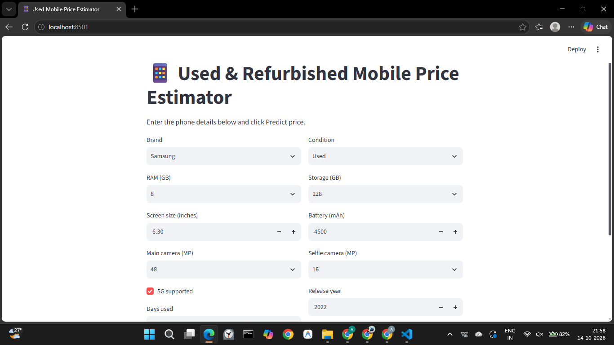
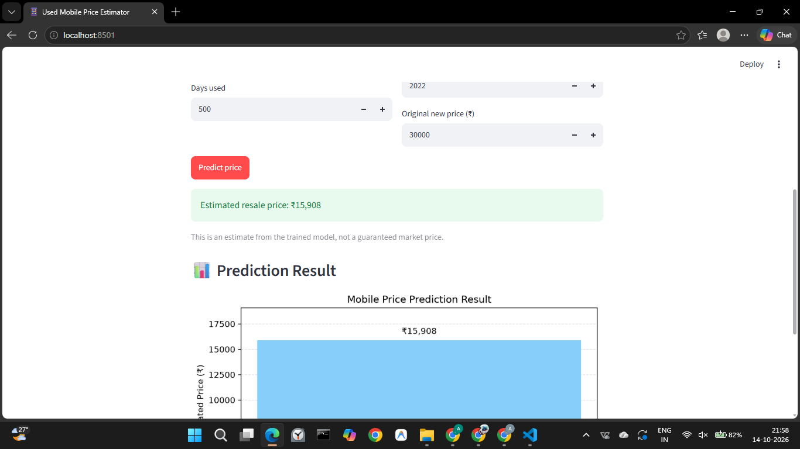
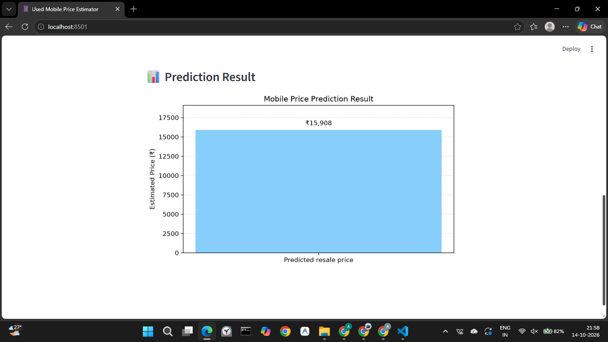

# 📱 Used & Refurbished Mobile Price Estimator

## Project Overview

This project uses machine learning to estimate the resale price of used and refurbished smartphones based on their specifications, age, usage, and condition.

**🚀 Live Application:** [Try the Mobile Price Estimator](https://used-mobile-price-estimator-n9tax8bjsmcwzqwfhujec7.streamlit.app/)

## Features

- Smartphone brand and operating system selection
- RAM and storage capacity
- Screen size and battery capacity
- Main and selfie camera specifications
- 5G support
- Phone age and days used
- Estimated resale price with a bar chart

## Application Screenshots

### 1. Application Interface



### 2. Price Prediction



### 3. Model Results



## Technologies Used

- **Python** – Application development and machine learning
- **Pandas and NumPy** – Data processing and numerical operations
- **Scikit-learn** – Machine learning model training and evaluation
- **Matplotlib and Seaborn** – Data visualization
- **Streamlit** – Interactive web application
- **Joblib** – Saving and loading the trained model

## Machine Learning Models

The project compares three regression algorithms:

1. Linear Regression
2. Random Forest Regressor
3. Gradient Boosting Regressor

Model performance is evaluated using:

- **MAE (Mean Absolute Error)**
- **RMSE (Root Mean Squared Error)**
- **R² Score (Coefficient of Determination)**

The best-performing model is saved as `price_model.pkl` and used by the application to generate price estimates.

## Dataset

The dataset is synthetically generated using Python for educational and demonstration purposes. It includes smartphone specifications, usage information, phone condition, and estimated resale prices.

The dataset is not intended to represent verified real-world smartphone market prices.

## How to Run Locally

### Prerequisites

- Python installed on your computer
- Git (optional, for cloning the repository)

### Step 1: Clone the Repository

```bash
git clone https://github.com/gouthamkrishna898/used-mobile-price-estimator.git
cd used-mobile-price-estimator
```

Alternatively, download the repository as a ZIP file from GitHub and extract it.

### Step 2: Install Required Packages

```bash
pip install -r requirements.txt
```

### Step 3: Generate the Dataset

```bash
python make_dataset.py
```

### Step 4: Train and Evaluate the Models

```bash
python model.py
```

This step trains and evaluates the regression models and saves the best-performing model as `price_model.pkl`.

### Step 5: Launch the Application

```bash
streamlit run app.py
```

Open the local URL displayed in the terminal to use the application.

## Project Structure

```text
used-mobile-price-estimator/
├── app.py
├── make_dataset.py
├── model.py
├── price_model.pkl
├── used_mobile_data.csv
├── requirements.txt
├── README.md
├── .gitignore
├── app-interface.png
├── price-prediction.png
└── model-results.png
```

*Note: This structure is illustrative. Actual files may differ depending on what is included in the repository.*

## Acknowledgements

The dataset used in this project was generated programmatically using Python for educational and experimental purposes. No external dataset was intentionally used as the primary source for training the model.

This project uses open-source libraries, including Pandas, NumPy, Scikit-learn, Matplotlib, Seaborn, Streamlit, and Joblib. These libraries are used subject to their respective licenses and terms of use.

## Dataset and Copyright Notice

The synthetic dataset was created for this project and is not intended to reproduce an externally sourced dataset. The generated values are illustrative and may not reflect actual smartphone resale prices.

The project does not claim ownership of third-party libraries or their associated materials. All third-party software remains subject to its respective license.

## Disclaimer

The predicted price is an estimate generated by a machine learning model trained on synthetic data. This project is intended for educational and demonstration purposes only. Predictions are not verified real-world market prices and should not be used as the sole basis for buying or selling decisions.

## Author

**Your Name**

GitHub: [gouthamkrishna898](https://github.com/gouthamkrishna898)

